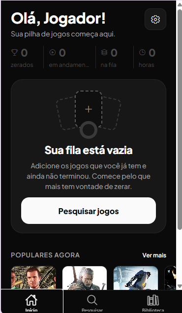
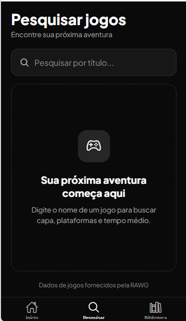
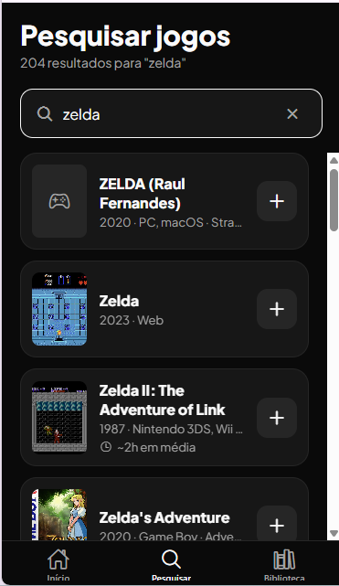
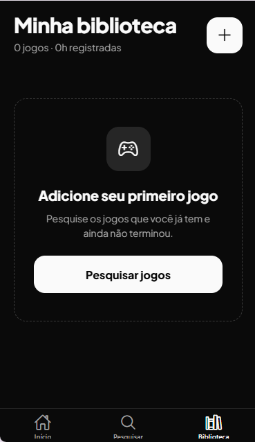
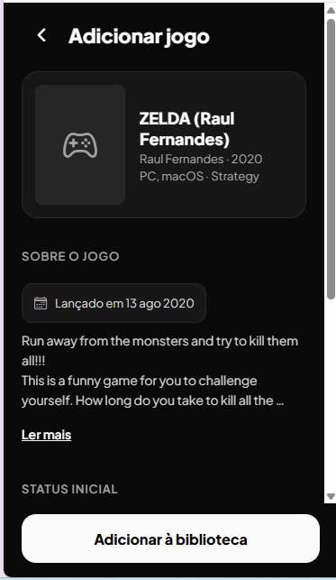
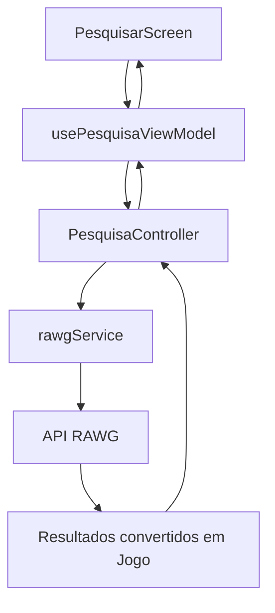
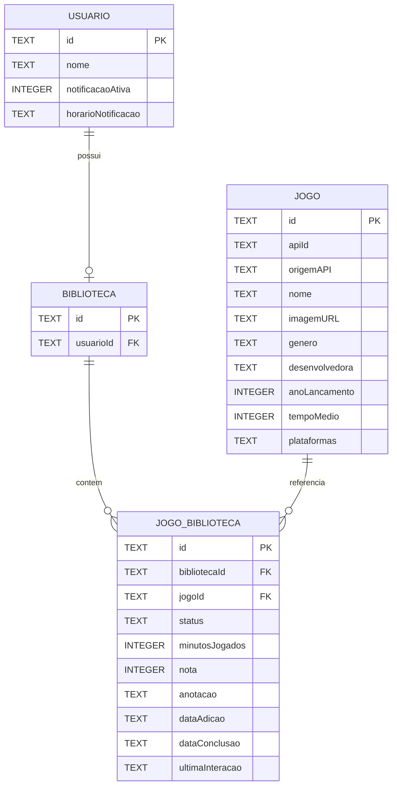

# GameStack

Aplicativo mobile para organizar seu backlog de jogos, acompanhar
o progresso e descobrir novos títulos.

## Sobre o projeto

O GameStack ajuda jogadores a organizarem os jogos que possuem,
mas ainda não terminaram.

O aplicativo permite acompanhar as horas jogadas, registrar
avaliações e anotações, organizar a fila de jogos e visualizar
estatísticas da biblioteca pessoal.

## Funcionalidades

- Pesquisa de jogos pela API RAWG.
- Biblioteca pessoal com filtros por status.
- Registro de horas jogadas.
- Avaliações de uma a cinco estrelas.
- Anotações pessoais.
- Acompanhamento do progresso.
- Estatísticas da biblioteca.
- Lembretes após cinco dias sem interação.
- Persistência local dos dados.

## Tecnologias

| Tecnologia | Finalidade |
| --- | --- |
| React Native | Desenvolvimento mobile |
| Expo SDK 57 | Ambiente de desenvolvimento |
| TypeScript | Tipagem e segurança do código |
| React Navigation | Navegação entre telas |
| Zustand | Gerenciamento de estado |
| SQLite | Banco de dados local |
| AsyncStorage | Preferências do usuário |
| SecureStore | Armazenamento seguro |
| RAWG API | Consulta de informações sobre jogos |
| Expo Notifications | Lembretes locais |

## Como executar

### Pré-requisitos

- Node.js 24.
- npm.
- Expo Go compatível com o SDK do projeto.
- Uma chave de acesso à API RAWG.

### 1. Clonar o repositório

```bash
git clone -b develop https://github.com/Micael-Martins/GameStack.git
cd GameStack
```

### 2. Instalar as dependências

```bash
npm install
```

Também é possível utilizar `npm ci` para instalar exatamente
as versões registradas no package-lock.json.

### 3. Configurar a API RAWG

Obtenha uma chave em:

https://rawg.io/apidocs

Crie o arquivo `.env` a partir do exemplo:

```bash
cp .env.example .env
```

No Windows PowerShell:

```powershell
Copy-Item .env.example .env
```

Preencha o arquivo `.env`:

```env
EXPO_PUBLIC_RAWG_KEY=SUA_CHAVE_AQUI
```

Nunca envie a chave real para o GitHub.

### 4. Iniciar o aplicativo

```bash
npx expo start
```

Escaneie o QR Code utilizando o Expo Go em um dispositivo
compatível.

Também estão disponíveis os comandos:

| Comando | Plataforma |
| --- | --- |
| npm run android | Android |
| npm run ios | iOS |
| npm run web | Navegador |

O aplicativo foi desenvolvido prioritariamente para Android
e iOS. A versão web possui limitações de persistência e
notificações, pois a implementação atual do SQLite é nativa.

## Telas do aplicativo

Capturas reais do GameStack em execução.

| Início | Pesquisa | Resultados |
| :---: | :---: | :---: |
|  |  |  |

| Biblioteca | Adicionar jogo |
| :---: | :---: |
|  |  |

> Capturas realizadas na versão web. A persistência SQLite está disponível no Android e iOS.


## Arquitetura MVVM

O projeto utiliza a arquitetura Model-View-ViewModel para
separar a interface, as regras de negócio e o acesso aos dados.

### Estrutura de pastas

```text
GameStack/
├── assets/
├── docs/
├── src/
│   ├── components/          # componentes reutilizáveis (estilo no próprio arquivo)
│   ├── data/
│   │   ├── db/              # SQLite: esquema e repositórios
│   │   ├── secure/          # SecureStore (chave da API)
│   │   ├── services/        # RAWG e notificações
│   │   └── storage/         # AsyncStorage (preferências)
│   ├── features/
│   │   ├── biblioteca/
│   │   │   ├── Model/       # regras puras da feature (testadas em tests/)
│   │   │   ├── ViewModel/   # um hook use<Tela>ViewModel por tela
│   │   │   └── Views/
│   │   │       ├── components/  # componentes só desta feature
│   │   │       └── styles/      # <Tela>Screen.styles.ts
│   │   ├── configuracoes/
│   │   ├── inicio/
│   │   ├── onboarding/
│   │   └── pesquisar/
│   ├── inicializacao/       # useIniciarApp: fontes, banco, notificações, splash
│   ├── models/              # tipos de dados (Jogo, JogoBiblioteca, Usuario...)
│   ├── navigation/          # rotas (RotasPrincipais, abas, tipos)
│   ├── store/               # store da biblioteca (Zustand) e regras de status
│   ├── theme/               # cores, tipografia, espaçamentos, bordas
│   └── utils/               # funções puras usadas por várias telas
├── tests/
├── App.tsx
└── package.json
```

Todas as features seguem a mesma divisão de `biblioteca/` (as pastas `Model/`,
`components/` e `styles/` só existem quando a feature precisa delas).

| Camada | Responsabilidade |
| --- | --- |
| Models | Entidades, tipos e estruturas de dados |
| Data | Banco de dados, repositórios e serviços externos |
| ViewModel | Estado das telas e regras de interação |
| Views | Interface visual e interação com o usuário |
| Store | Estado compartilhado da biblioteca; depois de cada mudança nos jogos, reagenda o lembrete |
| Components | Componentes visuais reutilizáveis |

### Exemplo: pesquisa de jogos



A tela recebe a interação do usuário. O ViewModel coordena
a pesquisa, o serviço consulta a RAWG e os resultados são
apresentados na interface.

## Banco de dados

O SQLite armazena os dados do usuário, sua biblioteca,
os jogos consultados e as informações de progresso.



Cada usuário possui no máximo uma biblioteca.

A tabela jogo_biblioteca relaciona os jogos à biblioteca
e registra as informações individuais de progresso.

A combinação de bibliotecaId e jogoId é única, evitando
duplicidades na biblioteca.

O tempo médio fornecido pela RAWG é registrado em horas,
enquanto o tempo jogado é armazenado em minutos.

## Regras de status

| Status | Comportamento |
| --- | --- |
| Na fila | Jogo aguardando início, sem nota ou data de conclusão |
| Jogando | Jogo em andamento, sem nota ou data de conclusão |
| Concluído | Registra a data de conclusão e a avaliação disponível |
| Abandonado | Limpa a data de conclusão e pode manter uma nota anterior |

Ao concluir pela tela de conclusão, o usuário precisa
selecionar uma avaliação de uma a cinco estrelas.

Toda mudança de status atualiza a última interação.

Ao registrar horas de um jogo Na fila, ele passa para Jogando.

O status Abandonado não é contabilizado como jogo concluído.

## Persistência de dados

| Tecnologia | Dados armazenados | Motivo |
| --- | --- | --- |
| SQLite | Usuário, biblioteca, jogos, horas, notas, anotações, status e lembretes | Dados relacionais e persistência local |
| AsyncStorage | Onboarding, pesquisas recentes e último filtro | Preferências simples |
| SecureStore | Chave da API RAWG | Armazenamento protegido pelo sistema operacional |

A chave RAWG é copiada do arquivo `.env` para o SecureStore
na execução do aplicativo nativo.

Variáveis EXPO_PUBLIC são incluídas no bundle do aplicativo.
O SecureStore protege os dados armazenados localmente,
mas não impede a extração de uma chave incluída no bundle.
Em produção, credenciais privadas devem permanecer em um servidor.

## Testes

Execute a suíte de testes automatizados:

```bash
npm test
```

Verifique a tipagem:

```bash
npx tsc --noEmit
```

Verifique a compatibilidade das dependências:

```bash
npx expo-doctor
```

Gere o bundle Android:

```bash
npx expo export --platform android
```

Os testes abrangem persistência, regras de status, pesquisa,
progresso, configurações e integração com os serviços.

## Git Flow

O desenvolvimento é organizado por branches:

- main: versão estável.
- develop: integração das funcionalidades.
- feature/*: implementação de funcionalidades.
- fix/*: correções.
- docs/*: documentação.

As alterações são enviadas por Pull Requests para develop,
permitindo revisão e validação pelos integrantes.

## Equipe

- [Agatha Karenne](https://github.com/AgathaKarenne)
- [BrunnoCC](https://github.com/BrunnoCC)
- [Débora Cristina](https://github.com/debCristina)
- [Micael Martins](https://github.com/Micael-Martins)

## Créditos

Os dados e as imagens dos jogos são fornecidos pela
[RAWG Video Games Database](https://rawg.io/).

Projeto acadêmico desenvolvido pela equipe GameStack.

## Licença

[MIT](./LICENSE)
